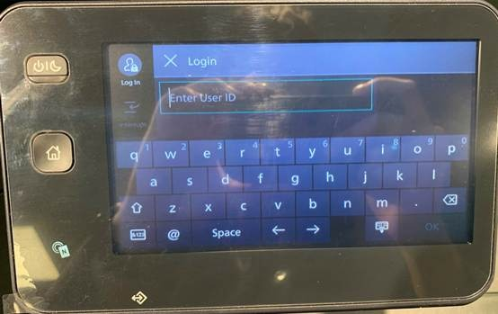

# 💻 Hướng dẫn sử dụng tính năng scan - máy in

***

**1.     HƯỚNG DẪN SỬ DỤNG MÁY SCAN**

Khi máy đang tắt, mở máy bằng phím  trên màn hình của máy

Máy sẽ hiện mình đăng nhập, với tính năng scan thì không cần đăng nhập, nhấn X để thoát ra

Đây là màn hình chính của thiết bị, chọn tính năng Scan

Sau khi vào tính năng scan, màn hình hiển thị các phương thức gửi file khi scan xong, đối với khách hàng chưa được cài đặt email, chọn Email dưới màn hình

Điền email muốn gửi file tới, sau đó nhấn OK

Nếu đã được IT cấu hình mail lên máy scan từ trước, vào phần Address book để chọn mail, không cần phải gõ mail lại từ đầu

Sau khi đã nhập mail cần gửi tới ( hiển thị trên màn hình ), trên màn hình phía bên trên, chọn Features để chỉnh các thông số scan

Có 3 thông số chính mà người dùng nên quan tâm

* 1: Color Scanning – Scan màu hoặc không màu – mặc định là có màu
* 2: 2 Sided Scanning – Scan 1 mặt hoặc scan 2 mặt – mặc định là 1 mặt
* 3: Resolution – Chỉnh độ phân giải scan – mặc định là 200dpi (tối ưu cho file gửi qua mail )

Nếu người dùng muốn chỉnh thông số, click vào từng lựa chọn để chỉnh

Có 2 cách đưa giấy scan vào máy

1: đưa vào khay phía trên ( Khuyên dùng )

<mark style="color:$danger;">LƯU Ý QUAN TRỌNG: THÁO BỎ TẤT CẢ KẸP GIẤY, NHÃN DÁN KHI SCAN, NẾU KHÔNG SẼ LÀM HỎNG MÁY</mark>

Khi scan ở khay phía trên máy, có thể scan nhiều tờ 1 lúc và scan 2 mặt

Cách 2: Đưa giấy vào khay dưới

LƯU Ý QUAN TRỌNG: THÁO BỔ TẤT CẢ KẸP GIẤY KHI SCAN, NẾU KHÔNG SẼ LÀM HỎNG MÁY

Với cách 2 có thể scan các tài liệu bị nhàu, rách, cần dán băng keo nhưng vẫn lưu ý là không được có kẹp ghim và chỉ có scan 1 mặt. Với cách scan này cần đặt mặt cần scan xuống dưới để máy có thể quét

Sau khi đã scan xong, nếu muốn scan tiếp, nhấn Change Settings , điều chỉnh các thông số cần ( nếu có) và nhấn scan thì máy sẽ tiếp tục nhận giấy để scan

Nếu đã scan xong, nhấn Complete Scan ( Sent ) để gửi file vừa scan xong qua Email

Sau khi nhấn Complete Scan ( Sent ), trên màn hình sẽ hiện thông báo lệnh gửi. nếu thành công, trên màn hình sẽ thông báo lệnh “ Complete” và đèn thông báo sẽ sáng màu xanh. với các trường hợp scan không thành công, hãy xem lại các bước trên hướng dẫn và nếu vẫn không scan được, hãy gọi lễ tân đến hỗ trợ

**Một số lỗi thường gặp khi scan**

**1.     Nhầm địa chỉ mail:** đối với lỗi này người dùng cần nhập đúng địa chỉ mail và scan lại từ đầu

**2.     Không cho giấy vào khi scan hoặc đưa giấy không đúng cách** dẫn đến máy báo lỗi

Lúc này cần người dùng bỏ giấy đúng cách vào khay scan của máy, sau khi đã chỉnh xong nhấn start là có thể scan tiếp được

**3.     Không nhận được mail scan**

Trong 1 số trường hợp, máy scan dù đã thông báo complete trên màn hình nhưng mail scan vẫn không nhận được, người dùng kiểm tra các thư mục như spam, rác hay kiểm tra lại địa chỉ nhận mail xem đã đúng chưa

**2.     HƯỚNG DẤN SỬ DỤNG TÍNH NĂNG COPY**

Khi hiện màn hình đăng nhập, người dùng đăng nhập tài khoản do IT cấp

Sau khi đăng nhập, chọn tính năng copy

Có 2 thông số mà người dùng cần quan tâm

* 1: Quantity – số bản photo – nhấn + - để tăng giảm số bản
* 2: 2 Sided – photo 1 mặt hay 2 mặt – người dùng chọn số mặt

Tiếp theo nhấn nút Start để bắt đầu photo

Trong quá trình photo sẽ có thể hết giấy, máy sẽ thông báo trên màn hình. Đối với trường hợp hết giấy, người dùng thông báo cho lễ tân để bổ sung giấy

**3.     HƯỚNG DẪN SỬ DỤNG TÍNH NĂNG COPY CCCD, GPLX**

Khi hiện màn hình đăng nhập, người dùng đăng nhập tài khoản do IT cấp

Sau khi đăng nhập, chọn tính năng Copy ( ID Card)

Đây là màn hình khi chọn tính năng, người dùng mở khay quét phía dưới của máy in

Để thẻ cần copy lên góc trái bên trên của máy quét và để mặt hình cần quét phía dưới ( như hình trên), sau đó đóng khay đó lại và bấm nút start trên màn hình

Sau khi máy quét xong sẽ nhảy ra thông báo là lật thẻ để quét mặt còn lại, người dùng mở khay quét của máy, lật thẻ và chỉnh thẻ đúng theo vị trí ban đầu, sau đó nhấn nút Start để quét tiếp mặt sau của thẻ, sau đủ 2 lần máy sẽ tự động copy ra 1 bản mới

 
